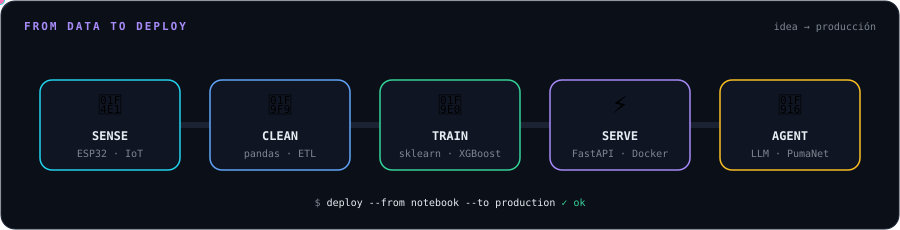
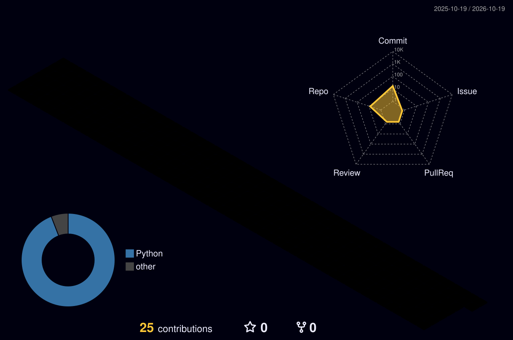

<!-- Header -->
<p align="center">
  
</p>

<p align="center">
  <a href="https://github.com/CZurita14">
    
  </a>
</p>

<p align="center">
  
  <a href="https://www.linkedin.com/in/christian-alejandro-zurita-betancourt-17a02641b"></a>
  <a href="mailto:christianzurita377@gmail.com"></a>
  
  
</p>

<p align="center">
  
</p>

---

## 🧠 Sobre mí

Soy **Christian Alejandro Zurita Betancourt**, desarrollador de software e IA desde **Ambato, Ecuador**. Me gusta llevar las ideas desde el prototipo hasta algo que la gente realmente use: **agentes de IA** que se coordinan entre sí, **modelos de Machine Learning** desplegados como APIs, y **sistemas IoT** que convierten sensores en dashboards útiles. Buena parte de mi trabajo está enfocado en el ecosistema académico: automatizar lo repetitivo para que docentes y estudiantes se concentren en lo importante.

```ts
const christian = {
  location: "Ambato, Ecuador 🇪🇨",
  role: "AI Engineer & Software Developer",
  focus: ["Agentes IA", "Machine Learning", "IoT", "Full-Stack"],
  currentlyBuilding: ["PumaNet", "Generador de Recursos IA", "Sílabos IA"],
  motto: "Si se repite, se automatiza.",
};
```

<p align="center">
  
</p>

## 🎯 Enfoque actual

- 🤖 **Orquestación de agentes IA** — PumaNet, un orquestador multi-agente para el entorno universitario.
- 📚 **IA aplicada a la educación** — generación de recursos didácticos, sílabos y matrices curriculares.
- 📊 **Machine Learning con impacto social** — clasificación de riesgo de desnutrición crónica infantil con XGBoost + FastAPI.
- 🌱 **IoT y sostenibilidad** — monitoreo de huella de carbono de residuos textiles con ESP32, Random Forest y Streamlit.
- 🫁 **Visión por computador en salud** — detección de anomalías pulmonares.

## 🛠️ Tech Stack

<p align="center">
  <br/>
  <br/>
  
</p>

## 🚀 Proyectos destacados

<table>
  <tr>
    <td width="50%" valign="top">
      <h3>🐆 PumaNet</h3>
      Orquestador de agentes IA para la Universidad Indoamérica. Coordina agentes especializados con proveedores LLM, herramientas y memoria.<br/><br/>
        
    </td>
    <td width="50%" valign="top">
      <h3>📚 <a href="https://github.com/CZurita14/Silabos-IA">Sílabos IA</a></h3>
      Extrae información curricular de PDFs y genera matrices de cruce asignatura ↔ competencias ↔ resultados de aprendizaje en Word.<br/><br/>
        
    </td>
  </tr>
  <tr>
    <td width="50%" valign="top">
      <h3>🎓 <a href="https://github.com/CZurita14/Equipo5-AgenteBecas">Agente de Becas</a> · <a href="https://github.com/CZurita14/Agente-Empleo">Agente de Empleo</a></h3>
      Agentes conversacionales que guían a estudiantes en procesos de becas y búsqueda de empleo.<br/><br/>
       
    </td>
    <td width="50%" valign="top">
      <h3>🫁 <a href="https://github.com/CZurita14/Machine-Learning-Anomalias-Pulmonares">Anomalías Pulmonares</a></h3>
      Modelo de Machine Learning para detectar anomalías pulmonares en imágenes médicas.<br/><br/>
       
    </td>
  </tr>
  <tr>
    <td width="50%" valign="top">
      <h3>🌱 <a href="https://github.com/CZurita14/Tesis">Huella de Carbono IoT</a></h3>
      Monitoreo pasivo de residuos textiles en una planta de denim (Pelileo): ESP32 + celdas de carga → ETL → Random Forest → dashboard Streamlit en tiempo real.<br/><br/>
        
    </td>
    <td width="50%" valign="top">
      <h3>🗓️ <a href="https://github.com/CZurita14/HorarioAulas">Horario de Aulas</a> · <a href="https://github.com/CZurita14/AppMovil">App Móvil</a></h3>
      Gestión de horarios y asignación de aulas, más una app móvil multiplataforma.<br/><br/>
       
    </td>
  </tr>
</table>

## 📊 Estadísticas en GitHub

<p align="center">
  
  
</p>

<p align="center">
  
</p>

<!-- Generados por .github/workflows/profile.yml -->
<p align="center">
  
</p>

<p align="center">
  <picture>
    <source media="(prefers-color-scheme: dark)" srcset="./dist/snake-dark.svg"/>
    
  </picture>
</p>

---

<p align="center">
  <i>“Si se repite, se automatiza.”</i> ⚡
</p>


